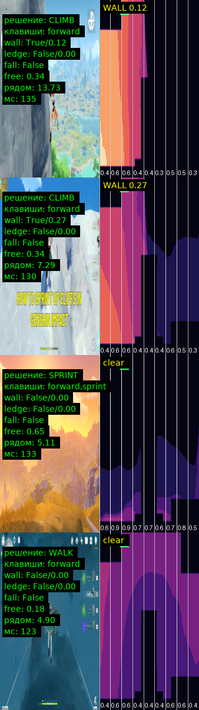

# Genshin Parkour — локальная навигация и паркур по карте глубины

Агент смотрит на экран Genshin Impact, лёгкая нейросеть превращает кадр в карту
глубины, а логика решает: идти, бежать, **карабкаться** (`Space`) или
**раскрыть планер** (`Space` в полёте). Ввод — настоящие клавиши и мышь, никаких
инъекций в процесс игры.

```
экран ──► Depth Anything V2 ViT-S int8 (27 МБ) ──► признаки сцены ──► правила ──► W/A/S/D, Space, Shift, мышь
          ~120 мс на 2 ядрах CPU (8 FPS)          стена/обрыв/падение    паркур    как у живого игрока
```

Задача из брифа — «если просто зажать W, персонаж упрётся в стену или упадёт со
скалы». Ровно это и решается здесь: двумя признаками сцены и правилами
безопасности вокруг них.



---

## 1. Что делает сеть

Монокулярная depth-сеть даёт **относительную** глубину: масштаб и сдвиг
неизвестны, «3 метра» из неё не получить. Поэтому все признаки — это отношения
внутри кадра, а не абсолютные метры:

| Признак | Как считается | Что значит |
|---|---|---|
| `wall` | профиль близости сверху вниз — **«плато»** (близко и у горизонта, и у груди, и перед ногами). Издалека он ещё и растёт сверху вниз; уперевшись вплотную — почти ровный, но середина кадра не дальше верха | впереди стена, надо карабкаться |
| `ledge` | **резкий скачок** профиля «далеко → близко» при пустой середине кадра | впереди край обрыва |
| `ledge_prox` | положение скачка по вертикали кадра | 0 = край далеко, 1 = вплотную |
| `falling` | **сырая** близость кадра (до нормировки) рухнула: ближайшая поверхность дальше 10 м **или** ниже 25% своей базовой линии, набранной на земле | персонаж падает → планер |
| `sector_free` | те же признаки по 9 колонкам кадра | куда безопасно шагнуть вбок |

Ключевой приём — **медленная нормировка** (`SlowNormalizer`): окно `[lo, hi]`
обновляется между кадрами, а не заново в каждом кадре (плюс ограничение на
сжатие окна). Без неё сеть «перенормирует» пустоту и все отношения ползут.

Но одной нормировки мало: **падение по нормированной карте неотличимо от
ходьбы** (проверено — доля «дали» и сдвиг сцены по вертикали дают одинаковые
значения). Поэтому падение решается по **сырой** близости, которую даёт сеть
до нормировки: `p98` обратной глубины. Стоя на земле пол в паре метров —
сотые доли; над пропастью ближайшая поверхность в десятках метров, и число
падает на порядок. Чтобы не «перекалиброваться» в полёте, базовая линия
обновляется только когда опора подтверждена (`raw >= 2.5 × air_abs_raw`).

Учтите: единицы сырой близости у Genshin-кадров (реальная сеть) и у
синтетического рендера разные — абсолютный порог `air_abs_raw` откалиброван
по синтетике. Для игры остаётся относительная ветка (падение к базовой
линии), а абсолютный порог фактически отключается: реальные кадры дают
`p98 ≈ 4.9–13.7`.

### Почему Depth Anything V2 ViT-S int8

Замер на этом же CPU (2 ядра), кадр 720p, `python -m parkour bench`:

| Модель | Размер | Вход | Задержка | Замечание |
|---|---|---|---|---|
| MiDaS small | 65 МБ | 256×256 | ~120 мс | старее, хуже на тонких скалах |
| DA V2 ViT-S fp32 | 99 МБ | 518×518 | ~800 мс | качество хорошее, но 1.2 FPS |
| **DA V2 ViT-S int8** | **27 МБ** | **294×168** | **~120 мс** | то же качество на глаз, **8 FPS** |
| DA V2 ViT-B | 389 МБ | 518×518 | секунды | для CPU нереально |

int8-квантование даёт 27 МБ и ~2× скорость при почти том же качестве — это и
есть «маленькая, быстрая и качественная» для реального времени. Профили
скорости настраиваются (`parkour bench`):

```
fast       266x154     p50  106 мс   9.4 FPS
balanced   294x168     p50  123 мс   8.2 FPS   <- по умолчанию
quality    336x196     p50  162 мс   6.2 FPS
max        448x252     p50  273 мс   3.7 FPS
```

Сеть нужна только одна — **depth**. Классификаторов «стена/обрыв» нет: правила
поверх карты глубины оказались и быстрее, и предсказуемее обучения на
синтетике (проверено в этом репозитории).

---

## 2. Логика паркура

Машина состояний, все пороги — в одной шкале (см. `parkour/config.py`):

```
WALK ──стена вплотную──► CLIMB   (Space импульсами + W)
  │  └──мало выносливости──► AVOID (обход сбоку)
  │  └──край впереди──────► AVOID: обход влево → обход вправо → GLIDE
  │  └──пустота под ногами► GLIDE   (Space: планер)
  └──свободно и прямо─────► SPRINT  (Shift)
```

Genshin-специфика, заложенная в правила:

* **`Space` — одна клавиша на три действия**: прыжок, карабканье, планер.
  «Карабкаться» значит удерживать `W` и подавать `Space` импульсами; в полёте
  `Space` **открывает** планер, а повторный — **закрывает**. Поэтому планер
  открывается ровно один раз за эпизод полёта, с паузой `glide_period_s`
  (это отдельно покрыто тестами — на этом легко спалить персонажа).
* **Карабканье почти везде**: если стена вплотную и есть выносливость —
  поднимаемся, а не ищем обход. Обход — только когда силы кончились.
* **Выносливость расходуется** на бег, карабканье и планер; при нехватке агент
  перестаёт карабкаться/планировать и отходит от края.
* **Планер — последняя ступень**: сначала два боковых обхода, и только если оба
  не помогли (край тянется во все стороны) — прыжок и планер.
* **В полёте не карабкаемся и не прыгаем**: склон внизу выглядит как «стена»,
  это отдельно отфильтровано, а инвариант «`falling` ⇒ только GLIDE» закреплён
  тестом по всем сценариям.

Про цель: агент идёт **туда, куда наведена камера** — в Genshin игрок уже навёл
её на сундук или квест-маркер. При обходе курс смещается на ±0.85 рад и
возвращается обратно; внешний азимут до цели (`goal_bearing`) подаётся каждый
кадр, а не копится внутри — иначе обход превращается в бегство от цели.

---

## 3. Быстрый старт

```bash
python -m venv .venv && . .venv/bin/activate
pip install -r requirements-dev.txt

python scripts/fetch_model.py          # 27 МБ, int8-модель -> models/
python -m pytest -q                    # 55 тестов
```

Что агент «видит» в типовых ситуациях (таблица без игры, модель не нужна):

```bash
python scripts/what_sees.py            # поле, стена, обрыв, карниз, полёт
python scripts/what_sees.py --real     # плюс реальные кадры Genshin
```

Разбор готовых кадров (без игры):

```bash
python -m parkour demo examples/screens/*.jpg examples/screens/*.png --out out/demo
```

Прогон по синтетическим сценариям (стена, обрыв, карниз, полоса препятствий,
спуск с утёса, полный провал):

```bash
python -m parkour simulate                  # таблица результатов
python -m parkour simulate --worlds fall --video out/fall.gif
```

Запуск на живой игре:

```bash
python -m parkour play --fps 10              # dry-run: считает, но не нажимает
python -m parkour play --act --fps 10        # реально нажимает клавиши
```

Замер скорости:

```bash
python -m parkour bench --images examples/screens/03_edge.jpg
```

### Настройки

```bash
python -m parkour config --out parkour.json
python -m parkour play --act --config parkour.json
```

Что крутить в первую очередь:

* `depth.input_hw` — компромисс «FPS ↔ качество» (по умолчанию 294×168);
* `perception.ledge_engage_prox` — насколько заранее агент реагирует на край;
* `policy.allow_glide_across` — разрешать ли прыжок с планером через провал;
* `policy.avoid_bearing` — насколько сильно уводит вбок при обходе.

---

## 4. Как проверялось

Настоящую игру в CI не запустить, поэтому в репозитории есть **синтетический
мир** (`parkour/sim.py`): heightfield из скал и пропастей, аналитический рендер
обратной глубины (луч против AABB — та же шкала `1/z`, что у сети) и физика в
духе Genshin (ходьба, спринт, карабканье, падение, планер, выносливость).

Это даёт замкнутый цикл «сцена → восприятие → решение → действие → сцена»:

```
flat     success=True   t= 7.4s  falls=0
wall     success=True   t=10.2s  climb=2.6s                 # залез на 7 м и дошёл
chasm    success=True   t=24.4s  falls=0                    # обошёл провал по берегу
ledge    success=True   t=11.8s  falls=0                    # прошёл по карнизу
course   success=True   t=53.2s  climb=2.2s glide=1.7s      # стена + провал + плато
glide    success=True   t=20.2s  glide=5.1s                 # спуск с утёса на планере
fall     success=True   t=19.0s  glide=8.4s                 # полный провал, спасся планером
итого: 7/7 сценариев пройдено, падений 0
```

Нарезки прогонов: `docs/sim_wall.png` (карабканье), `docs/sim_chasm.png`
(обход провала), `docs/sim_fall.png` (планер).

Тесты (`tests/`, 55 шт.) проверяют не «красивость кода», а свойства:

* стена распознаётся вплотную (в том числе уперевшись в неё лицом) и **не**
  распознаётся за 10 м; площадка под ногами и склон, видимый сверху, за стену
  не принимаются;
* падение распознаётся **с первого кадра** полёта, а стоя на земле или на
  высокой площадке — не распознаётся; порог «воздуха» масштабируется вместе
  с выходом сети;
* край обрыва виден заранее, `ledge_prox` растёт по мере приближения;
* на узком карнизе нет ложного обрыва (иначе агент вилял бы);
* HUD (миникарта, отряд, способности) не влияет на признаки;
* агент **никогда** не идёт вперёд у самого края при пустоте сбоку;
* без выносливости карабканье не начинается;
* планер открывается один раз за полёт, с паузой, и снова — после приземления;
* все 7 сценариев проходятся без падений, повторяемо (детерминизм);
* инвариант «`falling` ⇒ GLIDE и никаких прыжков» — по всем сценариям.

Проверка на настоящих кадрах Genshin (`examples/screens/`, см. картинку выше):

| Кадр | Что видит агент | Решение |
|---|---|---|
| скалолаз на скале (`01_climbing`) | `wall=True` (0.12) | `CLIMB` — идём карабкаться |
| герой на снежном склоне (`02_cliff`) | `wall=True` (0.27) | `CLIMB` |
| вид на долину с края (`03_edge`) | всё чисто, `free=0.65` | `SPRINT` |
| полёт на планере (`04_gliding`) | всё чисто, `free=0.18` | `WALK` |

Последний кадр — честная граница: по **одному** кадру в небе нет ни стены, ни
края, ни опоры, и он неотличим от «смотрим с утёса». Падение здесь не
объявляется намеренно: агент видит, что рядом есть поверхности (сырая близость
4.9 против 1.2 при карабканье), но это дальние скалы. В игре такой кадр идёт
**после** того, как планер уже открыт по предыдущим кадрам, и решение «планер
уже открыт» держится до приземления.

---

## 5. Границы применимости (честно)

* **Античит.** Genshin Impact — онлайн-игра с защитой. Здесь нет чтения памяти,
  инъекций и оверлеев — только пиксели экрана и настоящие клавиши, как у
  игрока. Но любой автоматический ввод остаётся на ваш риск: правила игры могут
  его запрещать. Для обучения и исследований безопаснее `--dry-run` и
  собственный клиент/симулятор.
* **Монокулярная глубина без калибровки** не даёт метров. Пороги откалиброваны
  на синтетике и проверены на кадрах; на вашем разрешении и настройках графики
  их стоит подстроить (`ledge_engage_prox`, `wall_knee_thr`).
* **Абсолютный порог падения — только для синтетики.** `air_abs_raw=0.10`
  выражен в единицах выхода сети, а у реальных кадров Genshin сырая близость
  на порядок больше (4.9–13.7). В игре фактически работает относительная
  ветка («близость упала к базовой линии»), а абсолютная отключается. Перед
  игрой стоит один раз прогнать `python scripts/what_sees.py --real` на своих
  кадрах и выставить `air_abs_raw` по ним.
* **Камера смотрит туда, куда её навели**. Маршрут «через полмира» агент не
  строит: он решает локальную задачу «пройти ближайшие 10 метров и не упасть».
  Для маршрута нужен азимут с миникарты — интерфейс для него есть
  (`goal_bearing`), а детектор миникарты — следующий логичный шаг.
* **Скорость.** 8 FPS на 2 ядрах CPU. На GPU (CUDA-провайдер onnxruntime)
  легко получить 30+ FPS; на слабом ноутбуке ставьте профиль `fast`.
* **Выносливость** определяется эвристикой по цвету полосы (`StaminaBar`), а не
  нейросетью — осознанно: лишняя сеть убила бы бюджет времени.

---

## 6. Структура

```
parkour/
  depth.py         ONNX-инференс + SlowNormalizer (медленное окно нормировки)
  perception.py    стена / обрыв / падение / свободные сектора из карты глубины
  policy.py        автомат паркура: CLIMB, AVOID, GLIDE, BACK_OFF, SPRINT
  config.py        все пороги и настройки (JSON)
  agent.py         продакшн-цикл: экран -> сеть -> правила -> клавиши
  input_backend.py захват экрана, эмуляция ввода, полоса выносливости
  sim.py           синтетический мир, рендер 1/z, физика персонажа
  runner.py        замкнутый цикл на синтетике (тесты и бенчмарк)
  viz.py, cli.py   визуализация и командная строка
tests/             55 тестов: восприятие, правила, сценарии, инварианты
scripts/           загрузка модели, запись демо, разбор «что видит агент»
examples/screens/  реальные кадры Genshin для проверки восприятия
docs/              нарезки прогонов и разбор кадров
```

## Лицензии и заимствования

* Depth Anything V2 — Lihe Yang et al., Apache-2.0; ONNX-экспорт
  (`fabio-sim/Depth-Anything-ONNX`), int8-квантование
  (`MartinDelophy/depth-anything-quantize`).
* Скриншоты в `examples/screens/` — превью из открытых публикаций, только для
  тестирования восприятия.
